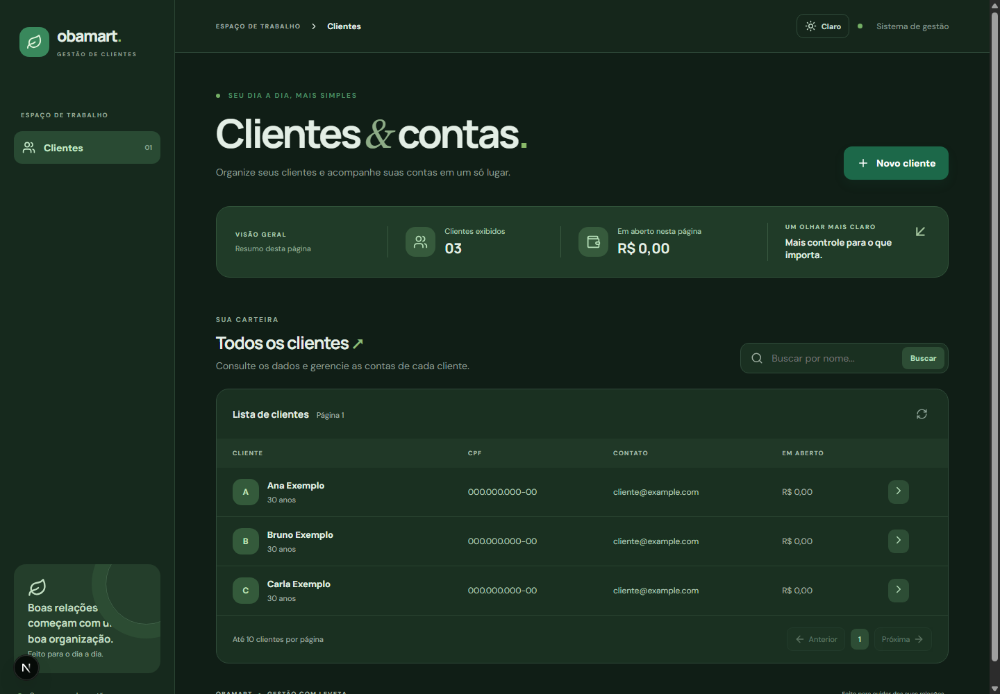
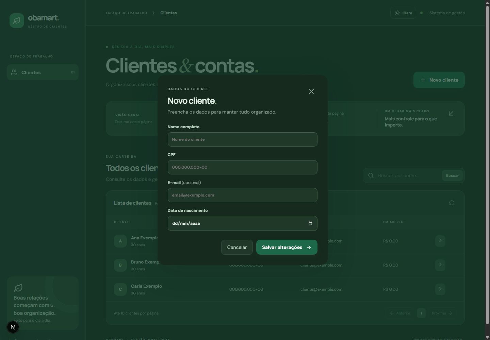

# Obamart

O Obamart é uma aplicação para cadastro de clientes e acompanhamento de suas contas. A interface web permite consultar clientes, registrar dívidas e acompanhar pagamentos; uma API .NET aplica as regras de negócio e armazena os dados em PostgreSQL.

## Funcionalidades

- Cadastro, busca, edição e exclusão de clientes.
- Registro, edição e exclusão de contas de cada cliente.
- Registro de pagamento e consulta ao histórico de contas.
- Listagens paginadas e resumo dos valores em aberto na página atual.
- Interface responsiva com temas claro e escuro.

Cada CPF pode ser cadastrado uma única vez, e cada cliente pode ter apenas uma dívida em aberto. A exclusão de um cliente também remove suas dívidas.

## Interface web

As capturas abaixo mostram a aplicação em execução. Os dados pessoais exibidos na lista foram substituídos por exemplos fictícios nas imagens.

**Lista de clientes e resumo da página**



**Cadastro de cliente**



## Tecnologias e organização

| Caminho | Responsabilidade |
| --- | --- |
| `Obamart.Web/` | Interface com Next.js, React e TypeScript. |
| `Obamart.Api/` | API HTTP em .NET 10. |
| `Obamart.Domain/` | Modelos, serviços e acesso aos dados. |
| `schema.sql` | Criação das tabelas e índices no PostgreSQL. |
| `docs/` | Documentação detalhada da API e da interface. |

O navegador acessa a aplicação Next.js, que encaminha as requisições `/backend/` para a API. A API utiliza o PostgreSQL para persistir os dados.

## Executar localmente

### Pré-requisitos

- SDK .NET 10.
- PostgreSQL e o cliente `psql`.
- Node.js e npm.

### 1. Preparar o banco

Crie um banco vazio chamado `obamart` e execute, na raiz do repositório:

```powershell
psql -U postgres -d obamart -f schema.sql
```

O script é destinado a um banco vazio. Para um banco existente, consulte as observações em [docs/API.md](docs/API.md).

### 2. Iniciar a API

Na raiz do repositório, configure a conexão com suas credenciais e inicie a API:

```powershell
$env:ConnectionStrings__Postgres = 'Host=localhost;Port=5432;Database=obamart;Username=postgres;Password=SUA_SENHA'
dotnet run --project Obamart.Api --launch-profile http
```

A API estará disponível em `http://localhost:5042`. Em desenvolvimento, sua especificação OpenAPI fica em `http://localhost:5042/openapi/v1.json`.

### 3. Iniciar a interface

Em outro terminal:

```powershell
cd Obamart.Web
npm install
npm run dev
```

Acesse `http://localhost:3000`. Por padrão, a interface usa a API em `http://localhost:5042`; para outro endereço, configure `API_URL` em `Obamart.Web/.env.local` e reinicie o Next.js. Se o PowerShell bloquear scripts, use `npm.cmd` no lugar de `npm`.

## Documentação

- [API: configuração, endpoints e regras](docs/API.md)
- [Web: estrutura, integração e funcionamento da interface](docs/WEB.md)
